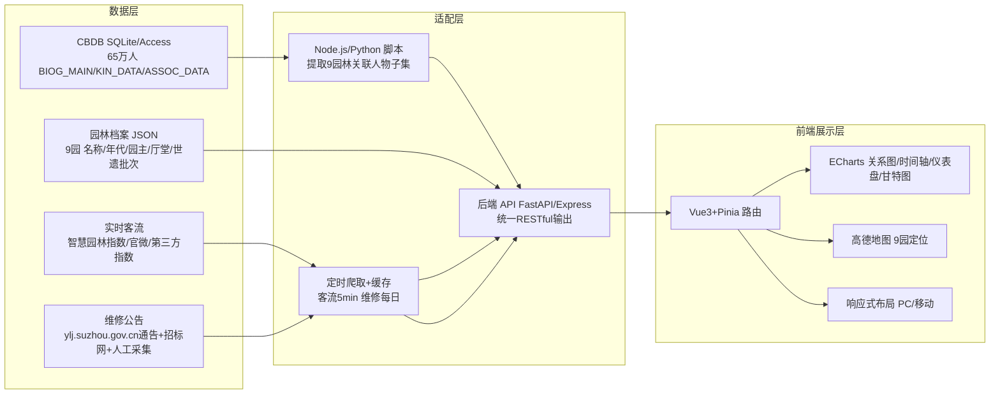

# 基于 CBDB 的苏州九座世界遗产园林动态展示方案

目的：

做一个针对苏州入选世界遗产的九座园林的展示网页。 其中包括 9座园林的历史（名称，主人，厅堂等元素） ，实时人数的展示，当前维修情况的展示。 都需要动态可视化。

整套方案的核心思路是：**以 CBDB 离线数据库为人物—关系底座，叠加园林档案、实时客流与维修公告三类异构数据，用 Vue3 + ECharts 构建多模块动态可视化的单页应用**。CBDB 提供从先秦到晚清约 65 万人的结构化传记数据，覆盖姓名、字号、籍贯、生卒、职官、入仕、亲属、社会关系、著作等十余张关联表，正是构建园林主人谱系与社会关系网络的理想数据源【turn1search11】【turn1search18】。实时客流与维修状态则属于"活态"数据，需通过苏州市园林和绿化管理局官方公告、智慧园林客流指数接口以及人工维护的结构化清单补足——目前公开渠道并不提供开放 API，需做适配层与降级方案。

## 一、总体技术架构



架构分为三层：**数据层**沉淀 CBDB 子集与园林档案；**适配层**把异构数据清洗为统一 RESTful 接口并做缓存；**展示层**用 ECharts 完成关系图、时间轴、客流仪表盘与维修甘特图四类动态可视化。CBDB 本身不提供"园林—主人—厅堂"的直接关联，需以人工编纂的 9 园档案为骨架，再把园主姓名回查 CBDB 拿到生卒、职官、社会关系，从而让"主人"变成有血有肉的历史人物节点。

## 二、九座园林基础档案（CBDB 锚点预填）

为您预填一份九园核心字段表，"代表园主"栏即建议在 CBDB 中检索的人物关键词，可直接作为 CBDB API/单机版的查询入口【turn0search17】【turn1search20】【turn1search26】：

| 园林 | 始建年代 | 入选世遗 | 代表园主（CBDB 检索锚点） | 核心厅堂/景致 | 叠山/设计名家 |
|---|---|---|---|---|---|
| 拙政园 | 明正德四年(1509) | 1997 | 王献臣、文徵明、陈之遴、王永宁、李秀成、张之万、张履谦 | 远香堂、待霜亭、三十六鸳鸯馆 | 文徵明参与设计 |
| 留园 | 明万历年间 | 1997 | 徐泰时、刘恕（寒碧山庄）、盛康 | 涵碧山房、冠云峰、林泉耆硕之馆 | 刘恕藏十二峰 |
| 网师园 | 南宋绍兴 | 1997 | 史正志、宋宗元、瞿兆骙、李鸿裔、何澄 | 万卷堂、殿春簃、月到风来亭 | 张大千兄弟借寓 |
| 环秀山庄 | 清乾隆 | 1997 | 蒋楫、毕沅、孙士毅 | 补秋舫、有谷堂 | 戈裕良湖石假山 |
| 沧浪亭 | 北宋庆历 | 2000 | 苏舜钦、韩世忠、宋荦 | 沧浪亭、复廊、看山楼 | 苏舜钦始创 |
| 狮子林 | 元至正二年(1342) | 2000 | 维则禅师、倪瓒、贝润生 | 燕誉堂、假山群、立雪堂 | 倪瓒参与造园 |
| 艺圃 | 明嘉靖 | 2000 | 文震孟、袁祖庚、姜埰 | 延光阁、博雅堂、乳鱼亭 | 文震孟旧居 |
| 耦园 | 清雍正 | 2000 | 陆锦、沈秉成、严永华 | 载酒堂、黄石假山、织帘老屋 | 顾沄规划设计 |
| 退思园 | 清光绪 | 2000 | 任兰生 | 退思草堂、菰雨生凉、闹红一舸 | 袁龙设计 |

## 三、CBDB 数据映射策略

CBDB 既提供在线 API，也提供 Access 与 SQLite 单机版（20250520 版含 649,533 人）【turn1search11】。对于本场景，**优先推荐 SQLite 单机版做本地子集提取**，避免在线 API 的频次限制与无批量下载约束【turn0search10】。

CBDB API 调用范式（以王献臣为例）：
- 按 ID 查询：`https://cbdb.fas.harvard.edu/cbdbapi/person.php?id={CBDB_ID}&o=json`
- 按姓名查询：`https://cbdb.fas.harvard.edu/cbdbapi/person.php?name=王献臣&o=json`
- 返回字段封装在 `Package.PersonAuthority.PersonInfo` 下，含基本信息、任官、社会关系、亲属关系等【turn1search1】【turn0search17】

关键数据表与园林场景的对应关系如下【turn1search12】【turn1search18】：

| CBDB 数据表 | 字段含义 | 园林场景用途 |
|---|---|---|
| BIOG_MAIN | c_personid、c_name_chn、c_index_year、c_birth_age、c_death_age | 园主基本信息卡 |
| ALTNAME_DATA | 字、号、室名、别号 | 展示"文衡山""寒碧主人"等雅号 |
| OFFICE_CODES / POSTED_TO_OFFICE_DATA | 官职与任职关系 | 园主身份标签（御史/侍郎/巡抚） |
| KIN_DATA | 亲属关系（五服内） | 沈秉成—严永华夫妇、徐泰时—徐溶父子 |
| ASSOC_DATA | 社会关系（近 250 种代码） | 文徵明—王献臣"友/幕客"、倪瓒—维则"方外" |
| BIOG_ADDR_DATA | 人物—地址关系 | 园主籍贯与园林所在地的时空映射 |
| TEXT_DATA | 人物—著述关系 | 《拙政园三十一景图》《寒碧庄十二峰图》 |
| EVENTS_DATA | 人物—事件关系 | 园林易主、太平天国占园等节点 |

**预处理流程**：先用人工整理的 9 园 × 多代园主姓名清单（约 60 人）批量回查 CBDB，提取这些人物及其一阶邻居（亲属+社会关系）形成一个约 300–500 人的子集，导出为本地 JSON。网页前端只加载这个子集，既保证响应速度，又避免每次访问 CBDB 服务器。

## 四、三大动态可视化模块

### 模块 A：历史信息（园名 / 园主 / 厅堂）可视化

此模块是 CBDB 的主战场，建议组合三种 ECharts 图表协同呈现：

**1）园主传承时间轴（ECharts timeline + 自定义 series）**
- 横轴为公元纪年（1509–1949），纵轴按 9 园分行
- 每个园主为一个色块条带，起止年取自 CBDB 的 c_birth_age/c_death_age 或指数年 c_index_year
- 时间轴 autoPlay 自动滚动，悬停弹出园主卡片（姓名、字号、职官、与园林关系）【turn1search31】

**2）社会关系力导向图（ECharts graph，layout: force）**
- 节点 = 园主 + CBDB 一阶关系人；边 = KIN_DATA/ASSOC_DATA 关系
- 边的颜色按关系类型编码（亲属—暖色、师生—冷色、政敌—红色）
- 点击节点可下钻到该人物的 CBDB 完整传记页【turn1search30】【turn1search37】
- 这是把"9 座园林"通过"人"打通的关键视图：例如文徵明同时连接拙政园（王献臣友人）与艺圃（文震孟家族），钱谦益、柳如是与拙政园产生交集，可在一张图上看出文人圈层的园林流转

**3）厅堂建筑分布图（SVG + ECharts overlay）**
- 每园一张手绘平面 SVG，厅堂为可点击热区
- 点击厅堂弹出该建筑的始建年代、命名典故、相关诗文（关联 TEXT_DATA）

### 模块 B：实时人数展示

苏州园林已有较成熟的客流监测基础——智慧园林信息平台通过 14 家基层单位 500 多处视频监控点和 2000 个传感器节点实时统计在园人数，并在黄金周等高峰期自动预警【turn0search22】【turn0search27】。但官方目前并未对第三方开放实时 API，公开渠道能拿到的是：

- "苏州园林官微""苏州园林旅游"微信公众号的实时客流展示【turn0search38】
- 第三方客流指数站点（如 modiauto.com.cn 提供拙政园等景区的客流指数、拥堵指数实时数据）【turn0search29】
- 文旅大脑对客流 72 小时预测，准确率约 92%【turn0search25】

因此推荐的数据获取与降级策略：

| 数据源 | 获取方式 | 更新频率 | 降级方案 |
|---|---|---|---|
| 官方智慧园林平台 | 联系苏州市园林绿化管理局申请数据接口 | 5 min | 不可得时降级 |
| 第三方客流指数 | Python 定时爬取 modiauto 等公开页 | 5 min | 解析失败时缓存上次值 |
| 历史客流拟合 | 基于节假日均值+当日天气+预约量回归预测 | 1 h | 作为可视化"模拟值"标识 |
| 人工维护上限 | 9 园最大承载量硬编码 | 静态 | 用作仪表盘满量程 |

**可视化形态**：
- 9 园总览仪表盘（ECharts gauge）：每园一个仪表，指针=实时人数，满量程=最大承载量，绿/黄/红三色区段对应舒适/较拥挤/预警
- 客流热力图（ECharts heatmap）：横轴为当日时段（8:00–18:00），纵轴为 9 园，颜色深浅=客流密度，便于横向对比"几点去哪个园最合适"
- 实时折线（ECharts line + dataZoom）：选某园后展开 24 小时客流曲线，叠加历史同期虚线对比

所有数据通过后端 WebSocket 或 5 min 轮询推送到前端，缓存到 Redis，避免重复请求源站。

### 模块 C：当前维修情况展示

维修数据来源最"碎"，需要聚合多渠道：

- 苏州市园林和绿化管理局官网"通知公告"栏（ylj.suzhou.gov.cn/szsylj/tzgg/）发布闭园、限流、应急抢修通告【turn0search37】
- 采招网、江苏招标网发布园林维修工程招标公告（如拙政园、环秀山庄园林建筑维修工程；拙政园、耦园、环秀山庄文物建筑应急抢修工程）【turn0search30】【turn0search39】
- "苏州园林"微博发布临时关闭通告【turn0search32】
- 苏州园林官微发布恢复开放通告【turn0search34】

**数据建模**：把每条维修/闭园信息结构化为：

```json
{
  "garden": "拙政园",
  "type": "修缮工程 | 应急抢修 | 闭园 | 限流",
  "scope": "全园 | 西部 | 某建筑",
  "start": "2025-03-01",
  "end": "2025-06-30",
  "status": "计划中 | 施工中 | 已完工",
  "source": "ylj.suzhou.gov.cn 通告 URL",
  "note": "远香堂屋面修缮"
}
```

**可视化形态**：
- 9 园维修甘特图（ECharts 自定义 series 模拟甘特）：横轴为本年月份，纵轴 9 园，色块=维修区间，颜色按 type 区分；这是宏观视图
- 维修状态卡片墙：每园一张卡片，顶部状态徽章（正常运营/局部施工/闭园修缮），点击展开详细工程列表与官方公告原文链接
- 维修历史时间轴：把历年招标公告、闭园通告按时间排列，可看出每园的修缮节奏（拙政园、环秀山庄近十年都有多次维修记录）【turn0search30】【turn0search39】

后端每日定时爬取上述四类来源，用关键词（园林名+维修/修缮/闭园/招标）过滤入库，并对去重做模糊匹配（同一工程招标公告与开工通告合并为一条记录）。

## 五、技术栈选型与降级策略

| 层次 | 首选技术 | 备选 | 说明 |
|---|---|---|---|
| 前端框架 | Vue 3 + Vite + Pinia | React 18 | 组合式 API 适合数据驱动视图 |
| 可视化库 | ECharts 5 | D3.js（仅复杂关系图） | ECharts 内置 graph/timeline/gauge/heatmap，开箱即用 |
| 地图 | 高德地图 JS API | Leaflet | 9 园精确定位与底图切换 |
| 后端 | FastAPI（Python） | Express（Node） | Python 便于 SQLite 查询与爬虫 |
| 数据库 | SQLite（CBDB 子集）+ Redis（缓存） | PostgreSQL | 单文件部署，CBDB 官方即提供 SQLite 版 |
| 部署 | Vercel + Cloudflare R2 | Nginx 自建 | 静态前端 + Serverless API |
| 爬虫 | requests + BeautifulSoup + APScheduler | Scrapy | 轻量定时任务 |

**降级策略**（必须预设，因为实时客流与维修公告都依赖非开放数据源）：
1. 客流 API 不可得 → 切换到"模拟值"模式，明确标注"基于历史数据估算"，避免误导
2. 维修公告源站改版 → 维护多套 CSS 选择器，失败时人工补录后台
3. CBDB 在线 API 限流 → 全部走本地 SQLite 子集，零外部依赖
4. 移动端性能不足 → 关闭力导向图自动布局，改为静态布局 + 按需展开

## 六、实施步骤建议

1. **数据准备（1–2 周）**：下载 CBDB SQLite 单机版【turn1search11】，编写 Python 脚本按九园林 60 位园主姓名回查，导出含 BIOG_MAIN、KIN_DATA、ASSOC_DATA、POSTED_TO_OFFICE_DATA 的子集 JSON；同步整理 9 园档案 JSON（名称/年代/厅堂/世遗批次）。

2. **后端搭建（1 周）**：FastAPI 提供四类接口——`/gardens`（档案）、`/persons/{garden_id}`（园主关系子图）、`/livestream/{garden_id}`（实时客流，含降级）、`/maintenance`（维修清单）。Redis 缓存 5 min 客流与每日维修。

3. **前端开发（2–3 周）**：按"总览—单园详情"两级路由组织。总览页放 9 园地图 + 客流仪表盘墙 + 维修状态卡；单园详情页放传承时间轴 + 关系力导向图 + 厅堂 SVG + 维修甘特。

4. **数据通路联调（1 周）**：爬虫定时任务上线，缓存命中率验证，降级模式手动触发测试。

5. **正式上线与运维**：每周人工巡检一次维修公告源站可用性，每月同步一次 CBDB 新版数据。

整体而言，CBDB 解决的是"园林背后的人"的结构化问题，让园主不再只是名字而成为有官职、有亲缘、有师承的历史节点；实时客流与维修公告则让"活的园林"被感知。三者在同一页面上联动——点开拙政园的某次修缮事件，能看到当年主持修缮官员的 CBDB 传记；点开某园主节点，能看到他与同时代其他园主的社交关系——这种"以人串园、以园见人"的叙事，正是 CBDB 数据价值在文化遗产展示中的独特发挥点。# 附录：方案评审与改进增补（2025-07）

> 以下是对原方案六章的系统性差距分析与改进建议，按优先级分为 P0（阻塞开工）、P1（V1 必须）、P2（V2 迭代）三级。

## 七、P0 级改进（开工前必须解决）

### 7.1 CBDB 人名消歧策略

原方案用 60 位园主姓名直接回查 CBDB，未处理同名问题。CBDB 中「王永宁」「宋荦」等可能有 2-5 条记录。

**消歧规则**（三约束逐级收窄）：

1. **籍贯匹配**：BIOG_ADDR_DATA 中的籍贯与园林所在地（苏州）一致则优先
2. **年代交叠**：c_index_year（指数年）与园林始建/易主年代窗口 ±50 年交叠
3. **官职佐证**：POSTED_TO_OFFICE_DATA 中有苏州/江南相关官职则加分

歧义仍不可解时，人工标注 `cbdb_id_confidence: "high" | "medium" | "low"`，前端对 low 置信度节点加虚线边框 + tooltip 提示。

### 7.2 API 接口契约（OpenAPI 3.0）

前后端并行开发的前置条件。四类接口需以下 schema：

```
GET /api/v1/gardens
  → { gardens: [{ id, name, name_cn, built_year, unesco_year, location: {lat,lng},
       owners: [{cbdb_id, name, period}], halls: [{name, built_year, note}] }] }

GET /api/v1/gardens/{garden_id}/persons
  → { nodes: [{cbdb_id, name, name_cn, birth_year, death_year, type, aliases, offices}],
      edges: [{source, target, relation_type, relation_label}] }

GET /api/v1/gardens/{garden_id}/livestream
  → { garden_id, current_count, max_capacity, level: "comfortable"|"busy"|"warning",
      hourly_history: [{hour, count}], updated_at }

GET /api/v1/maintenance
  → { items: [{id, garden_id, type, scope, start, end, status, source_url, note}] }
```

错误响应统一 `{ error: { code, message } }`，HTTP 状态码 200/400/404/500。

### 7.3 爬虫法律合规审查

**开工前必做**：
1. 检查 `ylj.suzhou.gov.cn/robots.txt` 是否允许爬虫
2. 查阅苏州市园林和绿化管理局网站"服务条款/版权声明"
3. 若禁止爬取：改用人工每周手动整理 CSV 作为数据源，后端直接读 CSV
4. 第三方客流站点同样需审查

**技术合规底线**：
- User-Agent 标识为 `ClassicGarden-Bot/1.0 (research project; contact@example.com)`
- 请求间隔 ≥ 5 秒
- 仅缓存必要字段，不全文存储原始 HTML
- 数据仅用于展示，不商用、不转售

---

## 八、P1 级改进（V1 必须）

### 8.1 拙政园单园原型（2 天低保真 Demo）

在正式前端开发前，先用纯 HTML + ECharts CDN 做一个拙政园单页 Demo：
- 硬编码 5 位园主 + 20 个关系节点的力导向图
- 单条园主传承时间轴
- 1 张厅堂 SVG（远香堂 + 待霜亭 + 三十六鸳鸯馆，3 个热区）
- 1 个客流仪表盘（模拟数据）

**验收标准**：PC 和移动端均能流畅交互，确认布局方案后再进入 Vue3 工程化开发。

### 8.2 力导向图性能基准与降级

| 场景 | 节点数 | 方案 | 预期帧率 |
|---|---|---|---|
| PC 单园详情 | ≤100 | ECharts graph force，全部展开 | ≥30fps |
| PC 全关系图 | ≤500 | ECharts graph force，初始仅展开选中节点 2 阶邻居 | ≥20fps |
| 移动端单园 | ≤50 | ECharts graph force，默认 1 阶邻居 | ≥20fps |
| 移动端全关系图 | — | 降级为**静态人物列表** + 点击展开卡片 | 即时渲染 |

### 8.3 Redis 缓存键设计

```
garden:{id}:livestream      → TTL 300s (5 min)    # 实时客流
garden:{id}:livestream:stale → TTL 3600s (1 h)    # 降级缓存
maintenance:list            → TTL 86400s (24 h)    # 维修列表
maintenance:list:stale      → TTL 604800s (7 d)    # 维修降级缓存
gardens:archive             → TTL ∞ (手动刷新)      # 园林档案
persons:{garden_id}         → TTL ∞ (手动刷新)      # 人物子图
```

### 8.4 SVG 厅堂图分期计划

原方案低估了 9 园厅堂 SVG 的制作成本（约 2-3 人月）。**分期策略**：

| 阶段 | 范围 | 形式 |
|---|---|---|
| V1 | 拙政园、留园（2 园） | 手绘 SVG + 可点击热区 |
| V1 | 其余 7 园 | 园林平面扫描图（PNG）+ ECharts scatter 叠加标记点 |
| V2 | 全部 9 园 | 统一手绘 SVG 风格 |

### 8.5 移动端差异化设计

| 模块 | PC 端 | 移动端（≤768px） |
|---|---|---|
| 9 园总览 | 3×3 仪表盘网格 | 横向轮播卡片（swipe），每卡一园 |
| 关系图 | 力导向图，可拖拽缩放 | 静态人物列表 + 点击展开关系子图 |
| 时间轴 | 横向滚动，9 园分行 | 纵向堆叠，单园切换 |
| 维修甘特图 | 横向甘特图 | 竖向卡片列表 |
| 地图 | 全幅高德地图 | 精简为 9 园列表 + 单园迷你地图 |

### 8.6 测试策略

| 层级 | 工具 | 覆盖范围 |
|---|---|---|
| 数据层 | Python `assert` + pytest | CBDB 子集导出脚本：断言 9 园各匹配 ≥1 人，一阶邻居 ≥200 人，无重复边 |
| API 层 | pytest + httpx | 四类接口冒烟测试：200 响应 + JSON schema 校验 + 降级模式触发 |
| 前端 | Playwright | 关键页面截图对比 + 移动端视口渲染测试 |
| 爬虫 | 手动触发 + 日志检查 | 每次运行后检查抓取条数 ≥ 历史均值 × 0.5 |

### 8.7 维修数据去重规则

```python
def is_duplicate(a, b):
    return (
        a["garden"] == b["garden"]
        and a["scope"] == b["scope"]  # 同园同建筑
        and abs((a["start"] - b["start"]).days) <= 30  # 开始日期 ±30 天
    )
```

招标公告与开工公告合并时，取最早 start 和最晚 end，status 以最新记录为准。

### 8.8 CI/CD 流水线

```
GitHub Actions:
  push main →
    - backend: pip install → pytest → (pass) deploy Railway
    - frontend: npm ci → npm build → (pass) deploy Vercel
  schedule (daily 2am) →
    - 触发 CBDB 子集同步脚本 → 生成 diff 报告 → 人工确认 PR
```

### 8.9 日志与监控

**结构化日志**（Python `logging` JSON 格式）：
```json
{"ts":"2025-07-20T08:00:01","module":"crawler.livestream","garden":"拙政园","count":1234,"duration_ms":3200,"status":"ok"}
{"ts":"2025-07-20T08:05:02","module":"crawler.maintenance","new_items":2,"duplicates":1,"duration_ms":5100,"status":"ok"}
{"ts":"2025-07-20T09:00:00","module":"crawler.maintenance","new_items":0,"status":"warning","reason":"zero_new_items_3rd_day"}
```

**健康检查端点**：`GET /api/v1/health` → `{ status: "ok", livestream_updated_at, maintenance_updated_at }`，外部 Uptime Kuma 每小时探测。

### 8.10 后端认证（管理后台）

```
POST /api/v1/admin/login  → { token: "jwt..." }
GET  /api/v1/admin/maintenance/pending  (需 Authorization header)
PUT  /api/v1/admin/maintenance/{id}  (人工审核/修改维修记录)
```

前台所有 `/api/v1/gardens/*` 和 `/api/v1/maintenance` 公开，无需认证。

---

## 九、P2 级改进（V2 迭代）

### 9.1 CBDB 版本同步自动化

```bash
# 每月执行
1. wget CBDB 新版 SQLite
2. python diff_schema.py → 若有表结构变更 → 通知人工
3. python extract_subset.py → 生成 cbdb_subset_{date}.json
4. python diff_subset.py old.json new.json → 生成变更报告
5. 人工确认后替换 api/data/ 下的 JSON
```

### 9.2 国际化的数据准备

V1 仅中文，但文本全部抽到 i18n JSON：
```json
// zh-CN.json
{ "garden.zhuozheng.name": "拙政园", "garden.zhuozheng.owner.0": "王献臣" }
// en.json (V2 补充)
{ "garden.zhuozheng.name": "Humble Administrator's Garden", ... }
```

ECharts 图表标题/图例同样走 i18n key。

### 9.3 无障碍（a11y）基线

- ECharts 配置 `aria: { enabled: true, decal: { show: true } }`
- 页面使用语义化 HTML（`<nav>`, `<main>`, `<article>`）
- 所有图标按钮加 `aria-label`
- 色彩对比度满足 WCAG 2.1 AA 级

### 9.4 实时客流 WebSocket 升级（V2）

V1 用 5 min 轮询；V2 在单园详情页升级：
```
GET /ws/gardens/{garden_id}/livestream
→ 每 60s 推送 {"count": 1234, "level": "comfortable", "ts": "..."}
```
后端 ASGI（FastAPI WebSocket），Redis pub/sub 广播。

### 9.5 数据源可达性预检清单

开工前逐项验证（可追加到项目 README）：

| 数据源 | URL | 验证项 | 状态 |
|---|---|---|---|
| CBDB SQLite | [GitHub Release](https://github.com/cbdb-project/cbdb-sqlite) | 可下载 + 表结构符合文档 | ⬜ |
| 苏州园林官微客流 | 微信公众号 | 手动截图确认有实时客流数字 | ⬜ |
| modiauto 客流指数 | modiauto.com.cn | HTTP 200 + 页面含目标数字元素 | ⬜ |
| 园林局通知公告 | ylj.suzhou.gov.cn | robots.txt 允许 + 页面结构稳定 | ⬜ |

### 9.6 改进后的实施路线图

| 步骤 | 内容 | 工期 | 前置 |
|---|---|---|---|
| **0. 开工准备** | P0 三项（人名消歧规则+ API schema + 爬虫合规） | 2 天 | — |
| **1. 数据准备** | CBDB 子集提取 + 9 园档案 JSON + 数据源可达性验证 | 1-2 周 | 步骤 0 |
| **1.5 原型验证** | 拙政园单园低保真 Demo | 2 天 | 步骤 1 |
| **2. 后端搭建** | FastAPI 四接口 + Redis 缓存 + pytest + /health | 1 周 | 步骤 0 |
| **3. 前端开发** | Vue3 总览 + 单园详情，PC + 移动端 | 2-3 周 | 步骤 1.5 |
| **4. 联调上线** | CI/CD + 爬虫上线 + 降级测试 + Uptime Kuma | 1 周 | 步骤 2+3 |
| **5. 运维迭代** | 周巡检 + 月 CBDB 同步 + V2 功能排期 | 持续 | 步骤 4 |
